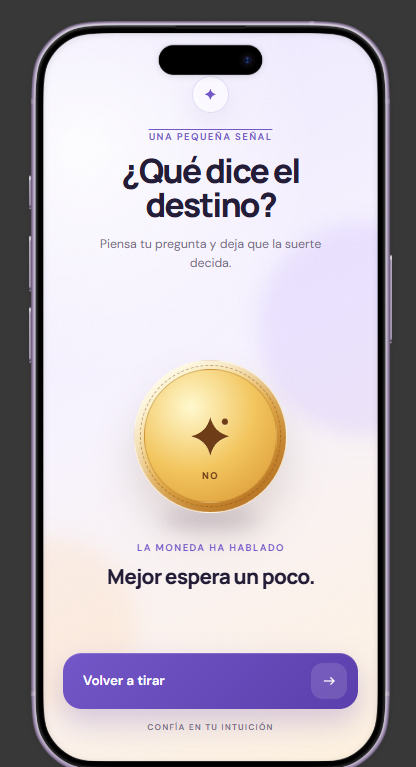

# Cara o Cruz

Aplicación Android minimalista para lanzar una moneda y dejar que el destino decida. Construida con Kotlin y Jetpack Compose.



## Características

- Lanzamiento de moneda con resultado aleatorio: **Cara** o **Cruz**.
- Animación de giro 3D con Jetpack Compose (`Animatable` + `rotationY`).
- Cambio de imagen sincronizado con el resultado final.
- Diseño responsive con fondo degradado y glows suaves.
- Modo claro y oscuro.
- Modal de configuración con switch de modo.
- Persistencia del modo seleccionado con `SharedPreferences`.
- UI 100% declarativa, sin layouts XML.

## Stack

- **Lenguaje:** Kotlin 2.2.10
- **UI:** Jetpack Compose + Material 3
- **Arquitectura:** MVVM básico
- **Estado:** `StateFlow`
- **Corrutinas:** `viewModelScope`
- **Persistencia:** `SharedPreferences`
- **Build:** Gradle 9.6.0 + AGP 9.4.1
- **SDK:** `minSdk 24`, `targetSdk 37`, `compileSdk 37`

## Requisitos

- Android Studio compatible con AGP 9.4.1.
- JDK compatible con el toolchain del proyecto (JDK 25).
- Android SDK 37 instalado.
- Dispositivo o emulador con Android 7.0 (API 24) o superior.

## Cómo ejecutar

1. Abrir la carpeta raíz del proyecto en Android Studio.
2. Esperar a que termine la sincronización de Gradle.
3. Seleccionar el módulo `app` y un dispositivo/emulador.
4. Ejecutar con el botón Run.

Por línea de comandos:

```powershell
.\gradlew.bat :app:assembleDebug
```

El APK se genera en:

```text
app/build/outputs/apk/debug/app-debug.apk
```

## Estructura del proyecto

```text
app/src/main/java/com/example/caraocruz/
├── MainActivity.kt
├── presentation/
│   └── coin/
│       ├── CoinFlipUiState.kt
│       ├── CoinFlipViewModel.kt
│       └── CoinFlipScreen.kt
└── ui/theme/
    ├── Color.kt
    ├── Theme.kt
    └── Type.kt
```

Recursos principales:

```text
app/src/main/res/
├── drawable-nodpi/
│   ├── coin_cara.webp
│   └── coin_cruz.webp
└── values/
    └── strings.xml
```

## Funcionamiento

1. El usuario toca **Tirar la moneda**.
2. `CoinFlipViewModel` elige aleatoriamente `CARA` o `CRUZ`.
3. Se emite el estado `Flipping` y la UI inicia la animación.
4. La moneda acumula 4 vueltas completas y ajusta el ángulo final según el resultado.
5. A los 1200 ms se emite `Result` y se muestra la cara correspondiente.

La animación usa `graphicsLayer` con `rotationY` y `cameraDistance` para simular profundidad. La cara trasera se compensa con 180° para evitar que se vea espejada.

## Personalización

- **Imágenes de la moneda:** reemplazar `coin_cara.webp` y `coin_cruz.webp` en `app/src/main/res/drawable-nodpi/`.
- **Duración del giro:** `FLIP_DURATION_MS` en `presentation/coin/CoinFlipViewModel.kt`.
- **Cantidad de vueltas:** `FLIP_FULL_TURNS` en `presentation/coin/CoinFlipScreen.kt`.
- **Colores:** `ui/theme/Color.kt` y `ui/theme/Theme.kt`.
- **Textos:** `app/src/main/res/values/strings.xml`.

## Estado actual

Implementado:

- Giro de moneda y resultado.
- Animación 3D.
- Modal de configuración.
- Selector de modo claro/oscuro.
- Persistencia del modo.

Pendiente:

- Feedback háptico.
- Efectos de sonido.
- Contenido adicional dentro del modal de configuración.
- Detalles visuales del mockup (badge, subtítulo y etiquetas).

## Documentación interna

- `AI_CONTEXT/AI_RULES.md`: reglas de desarrollo del proyecto.
- `AI_CONTEXT/PLAN.md`: plan técnico y estado de las fases.
- `AI_CONTEXT/IDEA_INICIAL.md`: idea original.
- `AI_CONTEXT/UI.png`: referencia visual.

## Repositorio

https://github.com/Tomii8r/Cara-o-Cruz
